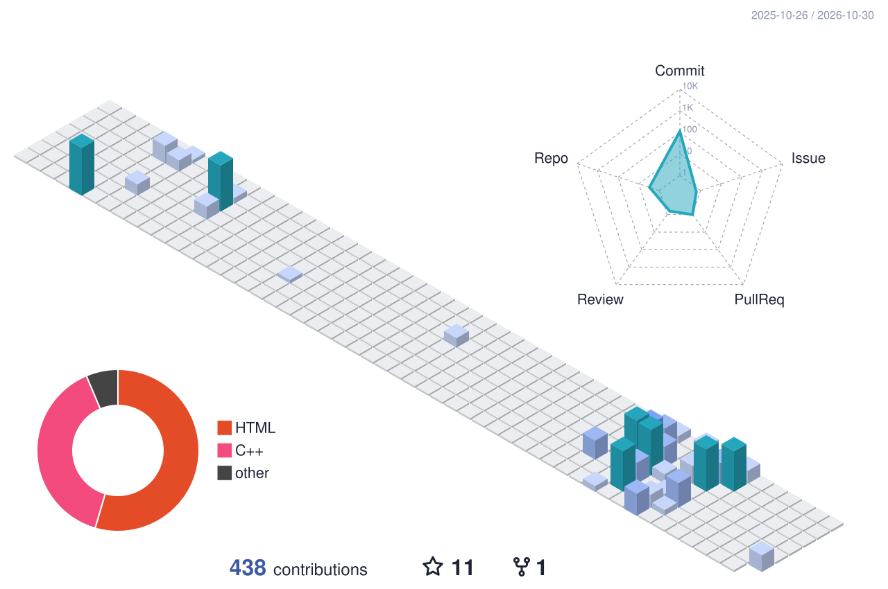

 

 

I'm an experimental physicist and Ph.D. candidate at the Department of Physics in Bari. I work on **astroparticle instrumentation** and **particle detectors**, from simulation to the lab bench to the data.

🔭 &nbsp;Astroparticle & space instrumentation 
⚛️ &nbsp;Particle detectors: design, simulation, characterization 
💻 &nbsp;Monte Carlo simulation & data analysis

 

**📚 Latest publications**

<!-- ORCID:START -->
📄 &nbsp;**[Performance Evaluation of the Readout Electronics Board Based on the Smart Asic for the Adapt Instrument](https://doi.org/10.3390/particles9010014)** 
&nbsp;&nbsp;&nbsp;&nbsp;&nbsp;*Particles* · 2026 &nbsp;

All works on [ORCID](https://orcid.org/0009-0008-9696-8935) →
<!-- ORCID:END -->

 

 

<table>
<tr>
<td width="50%" valign="top">

**🧊 [geantCAD](https://github.com/marcocecca00/geantCAD)** 
Interactive CAD-like editor: draw your detector in 3D, get a full Geant4 project out. 
  

</td>
<td width="50%" valign="top">

**⚛️ [QGSS2022](https://github.com/marcocecca00/QGSS2022)** 
Qiskit Global Summer School 2022: quantum simulation labs. 
  

</td>
</tr>
<tr>
<td width="50%" valign="top">

**🔬 [ParticleID](https://github.com/marcocecca00/ParticleID)** 
ML models classifying particles from e⁻p scattering detector responses. 
  

</td>
<td width="50%" valign="top">

**📉 [Bethe-Bloch](https://github.com/marcocecca00/Bethe-Bloch)** 
Stopping power of charged particles traversing matter. 
  

</td>
</tr>
</table>

 

